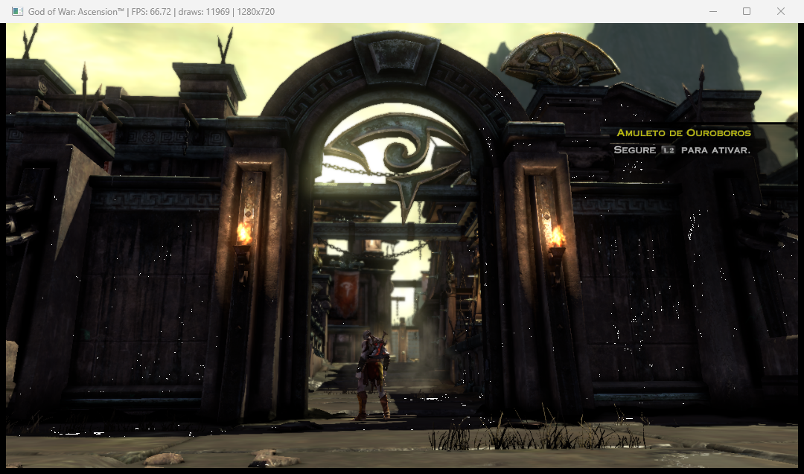
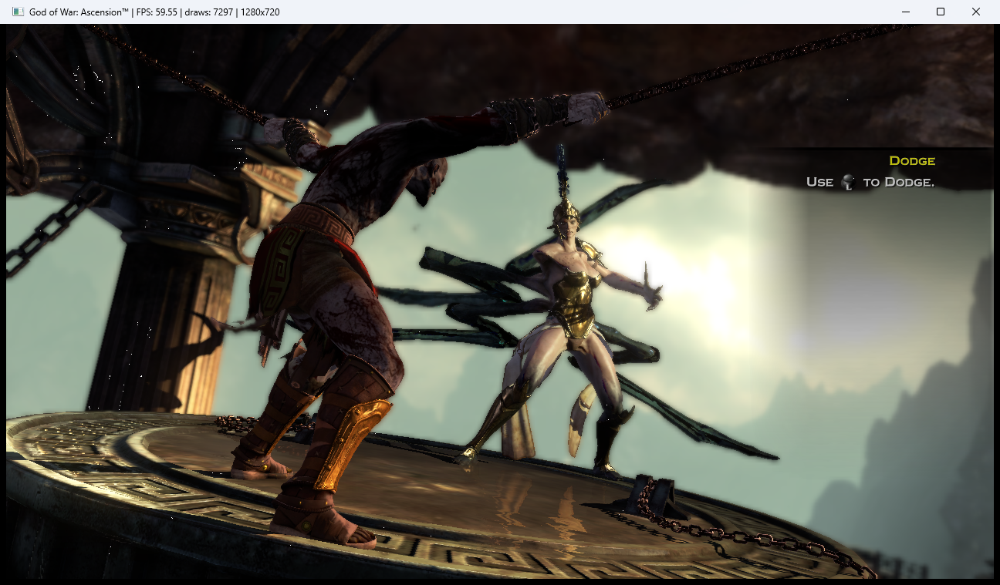
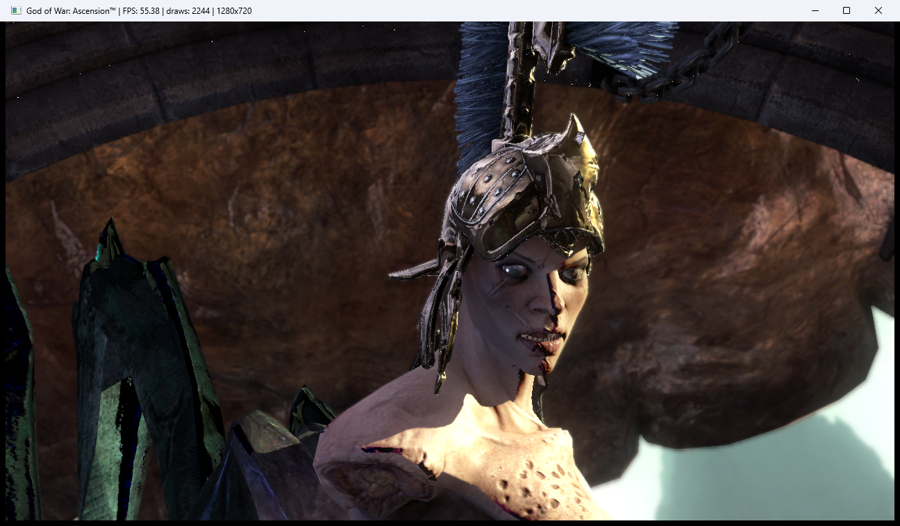
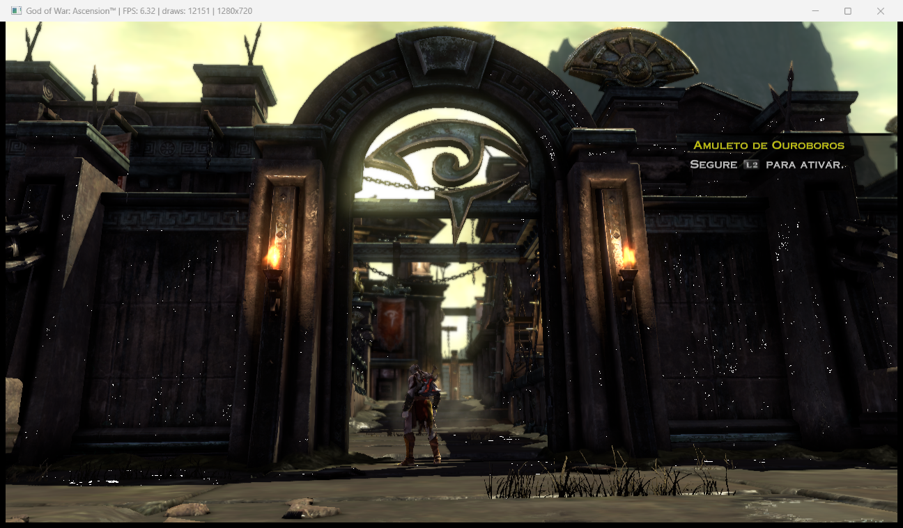

<h1 align="center">God of War: Ascension — port nativo para PC</h1>

<p align="center">
  <b>Recompilação estática do PS3 · Windows e Linux (SteamOS) · Direct3D 12 · sem emulador · traga o seu disco</b>
</p>

<p align="center">
  <a href="https://github.com/otavix010/otavix-launcher/releases/latest"></a>
  <a href="NOVIDADES.md"></a>
  <a href="LICENSE"></a>
  
  
  
</p>

<p align="center">
  <a href="#vers%C3%B5es-windows-e-linux">Windows e Linux</a> ·
  <a href="#como-jogar">Como jogar</a> ·
  <a href="#estado-atual">Estado atual</a> ·
  <a href="#requisitos">Requisitos</a> ·
  <a href="#perguntas-frequentes">Perguntas frequentes</a> ·
  <a href="NOVIDADES.md">Novidades</a> ·
  <a href="#english-summary">English</a>
</p>

> **Projeto de fãs, sem fins lucrativos, sem relação com a Sony.** *God of War* é marca registrada da Sony Interactive Entertainment. Este repositório **não contém o jogo** nem o firmware: você precisa da **sua própria cópia** do jogo (BCUS98232). O **update 1.04** e o **firmware oficial do PS3** são **gratuitos**, baixados direto da Sony (links em [Como jogar](#como-jogar)).

> [!IMPORTANT]
> **Para jogar, baixe o [Otavix Launcher](https://github.com/otavix010/otavix-launcher/releases/latest).** Ele baixa este port, gera o jogo no seu PC e o mantém atualizado sozinho. O port recebe **cerca de 6 atualizações por dia**, feitas a partir dos reports e pedidos dos jogadores: para relatar um problema ou pedir algo, use **"Reportar problema"** na página do jogo no launcher. O relatório já vai com o log, as configurações e as fotos, e é por ele que as correções saem mais rápido.
>
> **To play, download the [Otavix Launcher](https://github.com/otavix010/otavix-launcher/releases/latest).** It downloads this port, makes the game on your PC and keeps it updated by itself. The port gets **about 6 updates a day**, driven by players' reports and requests: to report a problem or ask for something, use **"Report a problem"** on the game's page in the launcher. The report carries the log, the settings and the screenshots, and that is how fixes come out fastest.



[English summary below](#english-summary)

## Versões: Windows e Linux

O port tem **duas versões**, geradas a partir do mesmo código e do mesmo disco:

| | **Windows** | **Linux / SteamOS** |
|---|---|---|
| Situação | **estável**, campanha completa jogada | **beta** (desde o Otavix Launcher 1.0.92) |
| Sistema | Windows 10/11 64 bits, GPU com Direct3D 12 | SteamOS (Steam Deck, Legion Go S) e Linux 64 bits, pelo Proton |
| Como jogar | pelo launcher, ou `gerar.cmd` e `jogar.cmd` | pelo launcher, ou `scripts/linux/gerar.sh` e `jogar.sh` |
| Vídeo | Direct3D 12 | Direct3D 12 pelo Proton (vkd3d, sobre Vulkan) |
| Build | AVX-512 se a CPU tiver, senão AVX2, senão a **compatível** (sem AVX2, mais lenta) | portátil (AVX2) |
| Desempenho medido | [tabela abaixo](#desempenho-medido) | [tabela abaixo](#desempenho-medido) e [docs/desempenho_portatil.md](docs/desempenho_portatil.md) |

Nas duas, **você traz o seu disco**: o launcher gera o jogo no seu aparelho a partir da sua cópia. Detalhes do Linux: [Linux / SteamOS (beta)](#linux--steamos-beta).

## O que é

Um port **nativo** do *God of War: Ascension* (PS3, 2013) para Windows e Linux. Não é um emulador: o código do jogo é **traduzido para C/C++ e compilado** para x86-64 (recompilação estática), em cima do [ps3recomp](https://github.com/sp00nznet/ps3recomp) do sp00nznet.

Como o código do jogo não pode ser distribuído, **o seu PC gera e compila a parte do jogo a partir da sua cópia**. Um comando só faz tudo.

| | |
|---|---|
|  |  |

## Como jogar

### Recomendado: pelo Otavix Launcher

O [Otavix Launcher](https://github.com/otavix010/otavix-launcher/releases/latest) junta tudo num lugar só: baixa este port, confere se o Python e as ferramentas do Visual Studio estão instalados, pede só a pasta do disco (o update 1.04 e o firmware o gerador baixa da Sony; quem já tiver os arquivos, inclusive o PS3UPDAT.PUP, pode escolhê-los), gera o jogo para a sua CPU e abre com as opções de vídeo e os saves. Quando sai uma versão nova, ele avisa e atualiza. É o jeito mais simples; o caminho à mão vem a seguir.

### À mão

**1. O que você precisa ter:** só a sua cópia do jogo. O update 1.04 e o firmware do PS3 são gratuitos, e o gerador baixa os dois sozinho dos servidores oficiais da Sony (o RPCS3 não é mais necessário).

| O quê | Onde conseguir |
|---|---|
| **O jogo**: a cópia do disco do *God of War: Ascension* **BCUS98232** (EUA) | A sua cópia, numa pasta que contenha `PS3_GAME`, ou ainda compactada (`.7z`, `.zip`, `.rar` ou `.iso` decriptada): o gerador extrai uma vez (uns 35 GB livres). |
| **O update 1.04** (grátis, ~235 MB) | **Baixado sozinho pelo gerador.** Se preferir baixar você mesmo: **[o update 1.04 no servidor da Sony](http://b0.ww.np.dl.playstation.net/tppkg/np/BCUS98232/BCUS98232_T76/5525fbb7b6b5456d/UP9000-BCUS98232_00-GOWABDPATCH00001-A0104-V0100-PE.pkg)** (o arquivo `.pkg`; SHA-1 do arquivo `5a94c17aa07cb5181a505d3429c88ea3d9f4e4d0`). Tem que ser a **1.04**: as versões 1.05 em diante não servem. Se você já instalou a 1.04 no RPCS3, serve também a pasta `RPCS3\dev_hdd0\game\BCUS98232`. |
| **O firmware oficial do PS3** (grátis, ~200 MB) | **Baixado sozinho pelo gerador**, do servidor de atualização do PS3. Se preferir baixar você mesmo: na [página oficial da PlayStation](https://www.playstation.com/pt-br/support/hardware/ps3/system-software/), botão **"Baixar atualização do PS3"** (o arquivo `PS3UPDAT.PUP`, que o gerador aceita direto). Também serve a pasta do RPCS3 com o firmware instalado. |

**2. Instale as ferramentas (uma vez só)**, num terminal:
```
winget install Python.Python.3.12
winget install Microsoft.VisualStudio.2022.BuildTools --override "--quiet --wait --add Microsoft.VisualStudio.Workload.VCTools --add Microsoft.VisualStudio.Component.VC.Llvm.Clang --add Microsoft.VisualStudio.Component.VC.CMake.Project --includeRecommended"
```

**3. Baixe este repositório** (botão *Code > Download ZIP*, ou `git clone`) e extraia numa pasta **sem espaços no caminho**, por exemplo `C:\gow-ascension-pc`.

**4. Clique duas vezes em `gerar.cmd`** e escolha a pasta do disco. Ele faz o resto sozinho:
- confere as ferramentas e baixa o FFmpeg;
- baixa o update 1.04 e o firmware oficiais (ou usa os seus: `-Update` e `-Firmware`);
- prepara os arquivos do jogo, sem copiar os 34 GB do disco;
- decripta o executável;
- traduz e compila, escolhendo a build certa para a sua CPU.

Num Ryzen 7 9800X3D (8 núcleos) leva ~5 minutos; num PC de 4 núcleos, bem mais. Se parar no meio, rode de novo: ele continua de onde parou.

Versão nova do port: baixe por cima e rode `gerar.cmd -RefazerDe 4` num terminal. Ele refaz só a tradução e a compilação, sem repetir o disco, o update e o firmware.

**5. Jogue com `jogar.cmd`.** O log fica em `out\jogo.log` e os saves em `saves\`.

Opções (defina antes de abrir o `jogar.cmd`; pelo launcher, elas ficam nas configurações do jogo):
- `GOWA_FLIP_HZ`: limitador, padrão 60. Acima de 60 o jogo **acelera** (parte da lógica avança por quadro); `0` = sem limite, com teto de 240.
- `GOWA_RES_SCALE`: resolução interna, 1 = 720p, 2 = 1440p, 3 = 4K.
- `GOWA_VRR`: VRR (G-SYNC / FreeSync), padrão 1: cada quadro vai para a tela assim que fica pronto, sem esperar a atualização dela. Num monitor sem VRR a imagem pode rasgar em movimento; `0` volta ao vsync (cada quadro espera a tela).
- `GOWA_OSD=1`: medidor de desempenho na tela (FPS, ms por quadro, uso e temperatura da CPU e da GPU, VRAM e RAM; a temperatura da CPU some quando o Windows só tem a zona térmica da ACPI, que em muitos desktops fica parada). Vem desligado; **F10** liga e desliga durante o jogo (`GOWA_OSD_TECLA=0` desativa a tecla).
- **Tela cheia sem bordas:** **F11** ou **Alt+Enter** (também o botão maximizar, ou Win+Cima) cobrem o monitor mantendo 16:9, com faixas pretas em telas de outro formato; F11, Alt+Enter ou **Esc** voltam para a janela. `GOWA_TELA_CHEIA=1` já abre assim.
- `GOWA_AUDIO_MUTE=1`: sem som.

O jogo grava um resumo de desempenho em `desempenho.json`, ao lado do exe (ou em `GOWA_PERF_JSON`): CPU, GPU e FPS médio, p1 e mínimo do tempo jogando. Não é enviado a lugar nenhum; o launcher só manda, e só com a sua autorização.

Detalhes de cada etapa, e como fazer à mão: [docs/COMO_GERAR.md](docs/COMO_GERAR.md).

### Linux / SteamOS (beta)

A versão Linux roda no SteamOS (Steam Deck, Legion Go S) e em outros Linux, pelo Proton. Já foi testada de ponta a ponta num **Legion Go S** (veja o desempenho): o launcher gera e abre o jogo (versão 1.0.92 ou mais nova do Otavix Launcher). Precisa de um Proton instalado na Steam, de `curl`, `python3`, `tar` e `xz`, de um processador com AVX2 e de uns 15 GB livres. À mão: `bash scripts/linux/gerar.sh --disco <pasta ou arquivo do disco>` (o update e o firmware são opcionais: `--update`, `--firmware`) e depois `bash jogar.sh`. O log fica em `out/jogo.log`. Sempre chame os dois scripts pelo `bash`. No SteamOS o launcher também cria o atalho do jogo na Steam. A geração é feita no próprio aparelho (traduz e compila o jogo uma vez, leva um bom tempo num portátil).

## Como funciona

O PS3 tem um processador central (PPU, PowerPC), seis co-processadores vetoriais (SPUs) e uma GPU (RSX):

- **PPU**: o executável do jogo é traduzido para C++ função por função pelo tradutor do ps3recomp, com os remendos do port aplicados por scripts.
- **SPU**: os programas das SPUs (jobs do SPURS, o EDGE de geometria, as tarefas de malha, o gerenciador de políticas) também viram C. Os laços mais pesados podem virar **núcleos vetoriais** gerados por scripts (AVX-512 ou AVX2), conferidos bit a bit. O código que o jogo carrega nas SPUs em tempo de execução e que não foi traduzido roda num interpretador.
- **SPURS**: a biblioteca de agendamento das SPUs (libsre) roda o código do firmware oficial (LLE).
- **RSX**: os comandos da GPU são desenhados em **Direct3D 12**, com os shaders do RSX convertidos para HLSL.
- **Áudio**: WASAPI, até 8 canais. Vídeos (MPEG-2) com FFmpeg.

## Estado atual

- **A campanha foi jogada inteira**, do primeiro ao último capítulo, no port (08/11/2026, engine 0.11.2). Vídeos, menus e saves funcionam.
- **60 FPS travados** em um Ryzen 7 9800X3D, com o limitador ligado (padrão). O desempenho depende muito da CPU (veja abaixo).
- **Atualizações todos os dias**, a partir dos relatos dos jogadores. O que mudou em cada uma está em [NOVIDADES.md](NOVIDADES.md) (também na página "Novidades" do jogo no launcher).
- Só a versão **BCUS98232 (EUA) com o update 1.04**: o `gerar.ps1` confere o executável e recusa outras.
- Ainda em andamento: desempenho em PCs de 4 núcleos e em placas de 8 GB de VRAM, e alguns detalhes visuais pontuais.

## Desempenho medido

**Capítulo 16** (a cena mais pesada) e **fase 1**, em FPS de jogo, **sem o limitador de 60** (é como dá para comparar máquinas). **O hardware muda tudo**: o gargalo é a CPU, e CPUs com AVX-512 rodam bem mais rápido.

| Máquina | Sistema | CPU | GPU | Build | Cap. 16 | Fase 1 |
|---|---|---|---|---|---|---|
| **PC 1** | Windows | Ryzen 7 9800X3D (8/16, AVX-512) | RTX 5080 | AVX-512 | **~68** | **~84** |
| **PC 2** | Windows | Core i5-11400F (6/12, AVX-512) | RX 9060 XT | AVX-512 (Rocket Lake) | **~32** (1ª execução) | — |
| **Notebook** | Windows | Core i5-10300H (4/8, sem AVX-512, ~2,8 GHz sustentado) | GTX 1650 | sem AVX-512 | **~8** | — |
| **Portátil** | **Linux** (SteamOS) | Ryzen Z1 Extreme (8/16), 15 W | Radeon 780M (integrada) | portátil (AVX2) | não medido | veja abaixo |

### Versão Compatível (sem AVX2) × versão normal

A diferença vem só das instruções (a mesma máquina nas duas), sem limitador, médias de 5 s, 0 travamentos. Combate pesado = checkpoint Cyn300; começo do jogo = checkpoint Stint500. Num processador antigo de verdade, com núcleos mais lentos, a queda é maior.

| Máquina | Cena | Versão normal (AVX2) | Versão compatível (sem AVX2) |
|---|---|---|---|
| **PC 1** (Ryzen 7 9800X3D, Windows) | combate pesado | 67,7–69,3 FPS | 24,0–24,3 FPS |
| **Portátil** (Legion Go S, SteamOS, 15 W) | combate pesado | ~25 FPS | 9,7 FPS |
| **Portátil** (15 W) | começo do jogo | ~48 FPS | 24,6 FPS |

### Portátil (Linux): Lenovo Legion Go S

Hardware: Lenovo Legion Go S (83N6), **AMD Ryzen Z1 Extreme** (8 núcleos, 16 threads), GPU integrada **Radeon 780M** (RDNA3), 32 GB de RAM de fábrica, com 8 GB reservados para a GPU (VRAM) e ~23 GB para o sistema (a VRAM reservada é configurável; ainda vamos testar com mais), SteamOS 3.10, Proton GE-Proton11-7. Port: build portátil (AVX2), 6 SPUs (padrão em aparelho com bateria), resolução interna 1280x720. Medido **sem o limitador de 60**, em 15 amostras de 5 s depois de carregar o checkpoint, com o Kratos parado na cena (não é o Cap. 16 nem a fase 1 do PC):

| Cena | 15 W | 30 W |
|---|---|---|
| Começo do jogo | **46–49 FPS** (25 min seguidos: média 48, mínimo 42,7, sem queda) | — |
| Cenas médias (Lan260, Fury300) | **~44 FPS** (mín. ~39–41) | **65–68 FPS** (mín. ~59–67; com o limitador de 60 fica travado em 60) |
| Combate pesado, muitos inimigos (Cyn300) | **~24 FPS** (mín. ~23), áudio pode cortar | em medição |

Nenhum travamento nem queda do jogo em cerca de 140 rodadas de teste. O combate pesado é o que estamos otimizando agora (no PC 1, essa mesma cena roda a ~48 FPS sem limitador). Os números por rodada estão em [docs/desempenho_portatil.md](docs/desempenho_portatil.md); o arquivo bruto fica no próprio aparelho de teste (`~/gowa-linux-teste/banc/resultados.txt`).

> **A build que o `gerar.cmd` produz agora tem o mesmo desempenho da nossa.** Os passes de desempenho que aplicamos ao longo do desenvolvimento entram na geração (`scripts/otimizar.py`). No notebook, no cap. 16, a build gerada empatou com a nossa (antes da automação, ela dava 3,9 FPS). Depois disso, com a fixação de threads desligada em CPUs com menos de 12 processadores lógicos, ela chegou a **~8 FPS** (média de 200 s de fase, rodadas intercaladas). O PGO fica de fora; o que ainda difere está no fim de [docs/COMO_GERAR.md](docs/COMO_GERAR.md).



O que medimos num PC fraco (4 núcleos, sem AVX-512), o que ajudou, o que não ajudou e como medir: [docs/DESEMPENHO_PC_FRACO.md](docs/DESEMPENHO_PC_FRACO.md).

## Requisitos

- **Windows 10/11 64 bits** e GPU com **Direct3D 12**, ou **Linux/SteamOS** com Proton (beta, veja [acima](#linux--steamos-beta); precisa de CPU com AVX2 e uns 15 GB livres).
- **CPU com AVX2** (Intel Haswell em diante, AMD Zen em diante). **Com AVX-512** (Ryzen 7000/9000, Intel 11ª geração desktop) é muito mais rápido; o `gerar.ps1` escolhe sozinho.
- **Sem AVX2** (Core i de 1ª, 2ª e 3ª geração, Xeon E3/E5 v1 e v2, AMD FX, APUs A8): existe a versão **Compatível**, que o gerador escolhe sozinho. Ela roda, mas com cerca de **um terço dos FPS** da versão normal. O mínimo é **SSE4.2**; Phenom II, Athlon II e Core 2 ficam de fora. Na opção "Versão do executável" do launcher dá para escolher "Compatível (sem AVX2, mais lenta)" à mão.
- 16 GB de RAM. Espaço em disco: ~35 GB para o jogo extraído (se estiver compactado) e ~3 GB para a geração e a build; o disco do jogo em pasta não é copiado.

## Problemas conhecidos

- **Engasgo na primeira entrada de cada área**: os shaders são compilados na hora e ficam em cache. O port já traz um pacote de **13,4 mil shaders pré-compilados**, que cobre o jogo inteiro, então isso deve ser raro.
- **Sem o limitador de 60** o jogo **acelera**, porque parte da lógica avança por quadro.
- **Quedas de FPS em cenas pesadas** (muitos personagens e efeitos ao mesmo tempo) em CPUs mais antigas ou de 4 núcleos: entram na fase de otimização, depois da versão 1.0.
- **Placas de 8 GB de VRAM** perto do limite podem trocar texturas sem parar (a textura some por um instante). Baixar a resolução interna ajuda.
- PC com 4 núcleos e sem AVX-512 roda, mas abaixo de 10 FPS nas partes mais pesadas.

## Perguntas frequentes

**A geração parou dizendo que o disco é de outra versão.**
O port só funciona com a versão americana, **BCUS98232**, com o update 1.04. Discos europeus (BCES01741) ou de outras regiões têm arquivos diferentes. No launcher, use **"Escolher o disco de novo"**.

**A geração parou dizendo que a cópia está criptografada.**
As `.iso` da Redump são cifradas (feitas para gravar discos). Use a pasta com `PS3_GAME` tirada do seu PS3 ou do RPCS3, ou uma `.iso` decriptada.

**A geração parou dizendo que a cópia está incompleta.**
Faltam arquivos do disco. Extraia ou copie o jogo de novo (confira o espaço livre e se o antivírus não apagou nada).

**O meu processador não tem AVX2. Roda?**
Roda, pela versão **Compatível**: atualize o port no launcher e gere de novo, que o gerador escolhe sozinho. Ela é bem mais lenta (cerca de um terço dos FPS da versão normal, e num 4 núcleos dessa época serão poucos FPS). O mínimo é SSE4.2 (Core i de 1ª geração em diante, AMD FX e os APUs A8); Phenom II, Athlon II e Core 2 não servem.

**O jogo abre e fecha, ou a imagem e o som congelam.**
Atualize o port pelo launcher (a engine 0.11.3 corrigiu uma trava com imagem e som parados). Se continuar, use **"Reportar problema"** logo depois, sem fechar o jogo: o relato leva o log.

**Como relato um problema ou peço algo?**
Pelo launcher, em **"Reportar problema"** na página do jogo. O relato já vai com o log, as configurações e as fotos, e é por ele que as correções saem mais rápido.

## Licença e créditos

- **Nosso código e ferramentas: [MIT](LICENSE).** O RPCS3 (GPL-2.0) foi usado como referência de comportamento; o código foi revisado linha a linha contra o do RPCS3 e nenhum trecho foi copiado. A única coincidência literal são duas tabelas de valores medidos do hardware, herdadas do ps3recomp.
- **[ps3recomp](https://github.com/sp00nznet/ps3recomp)**, de Ned Heller (sp00nznet), MIT: o tradutor, o runtime e o motor de desenho em que o port se apoia. A engine que partiu dele, a Otavix Engine PS3 (runtime e tradutor), vem compilada num pacote que o `gerar.ps1` baixa e confere pelo SHA-256; o aviso MIT do ps3recomp vai dentro do pacote (`engine/avisos/`).
- **`scripts/gpl/unself.py` e `scripts/gpl/pup_libsre.py` são GPL-2.0** (`scripts/gpl/COPYING`): o decriptador de SELF, que segue o `unself.cpp` do [RPCS3](https://github.com/RPCS3/rpcs3), e o que tira o `libsre.sprx` do `PS3UPDAT.PUP`, que segue o instalador de firmware do RPCS3. Os dois rodam como programas separados.
- **Chaves**: nenhuma chave foi criada por nós. As de decriptação de executáveis são lidas do código-fonte do RPCS3: o `gerar.ps1` baixa dois arquivos dele (`key_vault.cpp/.h`, numa versão fixa) para `dl\rpcs3_chaves`, ou usa os que você indicar com `-ChavesRpcs3`. A KLIC do jogo sai da sua própria cópia. A engine traz, como o ps3recomp original, chaves públicas de formatos do PS3.
- **[FFmpeg](https://ffmpeg.org)** (LGPL), baixado pelo `gerar.ps1` dos builds do BtbN, para os vídeos.
- God of War e God of War: Ascension são marcas da Sony Interactive Entertainment. Este projeto não é afiliado nem endossado pela Sony.

---

## English summary

A **native PC port** of *God of War: Ascension* (PS3) **for Windows and for Linux/SteamOS (beta)**, made by **static recompilation**: the game's PPU and SPU code is translated to C/C++ and compiled for x86-64 on top of [ps3recomp](https://github.com/sp00nznet/ps3recomp). The GPU command stream is rendered with Direct3D 12, and SPURS runs the official libsre module (LLE).

**Easiest: the [Otavix Launcher](https://github.com/otavix010/otavix-launcher/releases/latest)**, which downloads this port, asks for your folders, generates the game for your CPU and starts it. **Bring your own disc**: no game code or data and no firmware here. You need your own copy of the game (BCUS98232). Update 1.04 and the official PS3 firmware are free from Sony, and `gerar.cmd` downloads both from Sony's servers by itself (or use your own: [update 1.04 .pkg](http://b0.ww.np.dl.playstation.net/tppkg/np/BCUS98232/BCUS98232_T76/5525fbb7b6b5456d/UP9000-BCUS98232_00-GOWABDPATCH00001-A0104-V0100-PE.pkg) (must be exactly 1.04), and `PS3UPDAT.PUP` from [PlayStation's PS3 system software page](https://www.playstation.com/en-us/support/hardware/ps3/system-software/); RPCS3 is no longer needed). Install Python and the Visual Studio 2022 Build Tools with Clang (commands above), download this repository to a path without spaces, double-click **`gerar.cmd`** (it asks for the disc folder, then downloads the update and firmware, decrypts your copy, translates and builds; ~4 minutes on an 8-core Ryzen 7 9800X3D), then play with **`jogar.cmd`**.

Platforms: **Windows 10/11** (stable) and **Linux/SteamOS** (beta, through Proton, since Otavix Launcher 1.0.92; tested end to end on a Lenovo Legion Go S, Ryzen Z1 Extreme, SteamOS 3.10). Handheld results, uncapped: 46-49 fps at the start of the game at 15 W, ~44 fps in medium scenes at 15 W and 65-68 fps at 30 W, ~24 fps in heavy combat at 15 W (being optimized); details in [docs/desempenho_portatil.md](docs/desempenho_portatil.md). In the tables the machines are named PC 1 (Ryzen 7 9800X3D), PC 2 (i5-11400F), Notebook (i5-10300H) and Handheld (Legion Go S).

Status: boots, menus, chapter 1 and chapter 16 play with correct image, 60 FPS locked on a Ryzen 7 9800X3D; the full game is not verified yet. Performance is CPU-bound and much better with AVX-512: ~68 FPS uncapped in chapter 16 on a 9800X3D, ~32 on an i5-11400F, ~8 on a 4-core laptop without AVX-512. The build `gerar.cmd` produces includes the same performance passes as ours (`scripts/otimizar.py`); only PGO is left out. Thread pinning is now off on CPUs with fewer than 12 logical processors (+4% on the laptop), and the GPU command reader no longer hangs on slow PCs.

License: our code is MIT; ps3recomp is MIT (Ned Heller); `scripts/gpl/unself.py` and `scripts/gpl/pup_libsre.py` are GPL-2.0 (they follow RPCS3's unself.cpp and firmware installer). Decryption keys are read from RPCS3's source (downloaded at a pinned commit). *God of War* is a trademark of Sony Interactive Entertainment; this is a non-commercial fan project, not affiliated with or endorsed by Sony.
