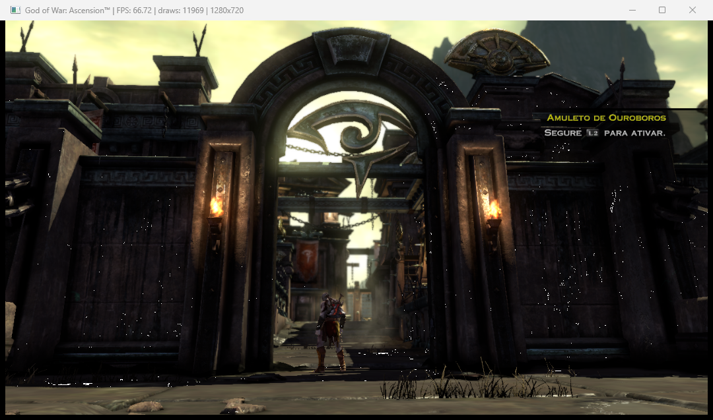
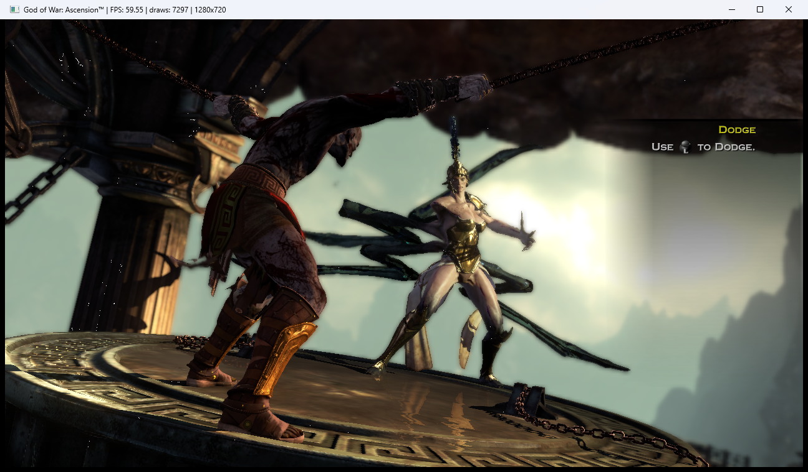
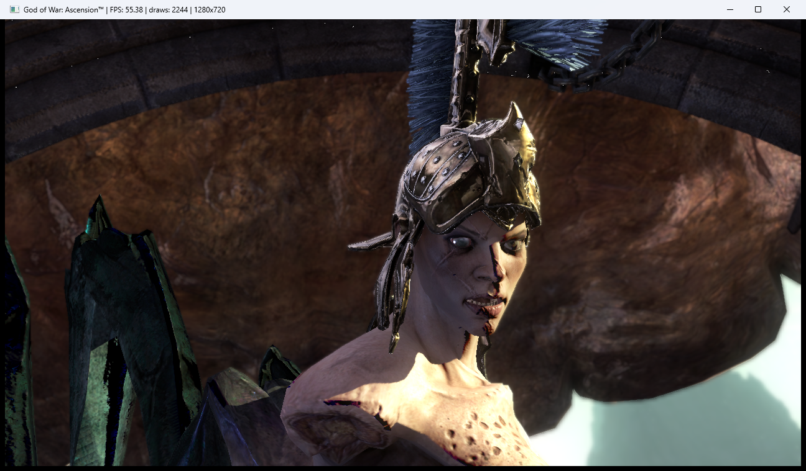
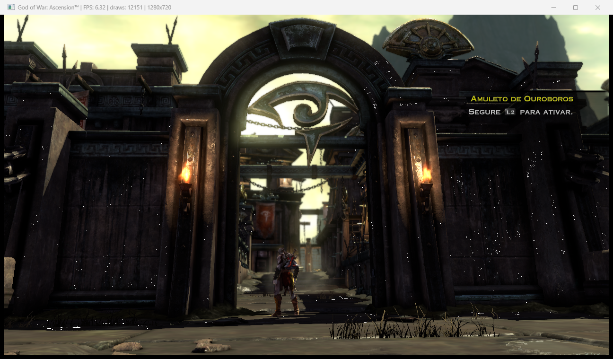

# God of War: Ascension — port nativo para PC

> **Projeto de fãs, sem fins lucrativos, sem relação com a Sony.** *God of War* é marca registrada da Sony Interactive Entertainment. Este repositório **não contém o jogo**, nem código ou dados do jogo, nem firmware, nem chaves. Para usar, você precisa da **sua própria cópia** do jogo (BCUS98232, com o update 1.04) e do firmware oficial do PS3.



[English summary below](#english-summary)

## O que é

Um port **nativo** do *God of War: Ascension* (PS3, 2013) para Windows. Ele não é um emulador. O código do jogo é **traduzido para C/C++ e compilado** para x86-64 (recompilação estática), em cima do [ps3recomp](https://github.com/sp00nznet/ps3recomp) do sp00nznet. O resultado é um `gowa.exe` que roda o jogo direto no PC.

Segue o modelo **"traga o seu disco"**, o mesmo dos outros ports feitos com ps3recomp: aqui ficam só o nosso código e as ferramentas. A parte que vem do jogo é gerada no seu PC, a partir da sua cópia (veja [docs/COMO_GERAR.md](docs/COMO_GERAR.md)).

| | |
|---|---|
|  |  |

## Como funciona

O PS3 tem um processador central (PPU, PowerPC), seis co-processadores vetoriais (SPUs) e uma GPU (RSX). Cada parte é tratada assim:

- **PPU**: o executável do jogo (`GOWA.elf`, decriptado do `GOWA.SELF`) passa pelo tradutor do ps3recomp (`tools/ppu_lifter.py`), que gera C++ função por função. Os remendos e ajustes deste port são aplicados por scripts sobre o código gerado.
- **SPU**: os programas das SPUs (módulos de job do SPURS/WWS, o EDGE de geometria, as tarefas de malha, o gerenciador de políticas) também são traduzidos para C. Os laços mais pesados viram **núcleos vetoriais** gerados por scripts (`scripts/vetorizar_*.py`): 4 iterações por instrução em AVX-512, ou em 2×256 bits em AVX2. Todos são conferidos bit a bit contra a tradução literal. O código que o jogo copia para as SPUs em tempo de execução e que não foi traduzido roda num interpretador.
- **SPURS**: a biblioteca de agendamento das SPUs (libsre) roda por **LLE**, ou seja, o código do módulo do firmware oficial, não uma reimplementação.
- **RSX**: os comandos da GPU são lidos da fila (FIFO) e desenhados em **Direct3D 12** pelo motor "live-draw" do ps3recomp, com os shaders do RSX convertidos para HLSL.
- **Áudio**: WASAPI, até 8 canais. Os vídeos (MPEG-2) são decodificados com FFmpeg.

O diário técnico completo das decisões está no histórico de commits. Os relatórios de desempenho estão em [docs/](docs/).

## Estado atual

- Abre, passa pelos vídeos e menus, carrega saves e roda a **fase 1** e o **Capítulo 16** (a parte mais pesada que testamos) com imagem correta: texturas, iluminação, sombras, desfoque e interface.
- **60 FPS travados** nas duas cenas num PC de topo (9800X3D), com o limitador de 60 ligado (padrão).
- O jogo inteiro, do começo ao fim, **ainda não foi verificado**.
- Testado só com a versão **BCUS98232 (EUA) 1.04**.

## Desempenho medido

Números do **Capítulo 16** (a cena mais pesada) e da **fase 1**, em FPS de jogo, **sem o limitador de 60**. É o jeito de comparar máquinas; no uso normal o limitador fica ligado. **O hardware muda tudo**: o gargalo é a CPU (a emulação das SPUs), e a diferença entre CPUs com e sem AVX-512 é grande.

| PC | CPU | GPU | Build | Cap. 16 | Fase 1 |
|---|---|---|---|---|---|
| Principal | Ryzen 7 9800X3D (8/16, AVX-512) | RTX 5080 | principal (AVX-512) | **~68** (60 com limitador) | **~84** (60 com limitador) |
| PC teste 2 | Core i5-11400F (6/12, AVX-512) | RX 9060 XT | Rocket Lake (AVX-512) | **~32** (1ª execução) | — |
| Notebook | Core i5-10300H (4/8, **sem AVX-512**, ~2,8 GHz sustentado) | GTX 1650 | portátil x86-64-v3 | **~5,7** | — |



Na mesma CPU (9800X3D), a build portátil sem AVX-512 fazia ~33 no cap. 16, metade da principal. Desde então ela ganhou o modo de arredondamento para zero e os núcleos vetoriais em AVX2.

## Requisitos

- **Windows 10/11 64 bits** e GPU com **Direct3D 12**.
- **CPU**, em uma de duas builds:
  - **principal (AVX-512)**: Ryzen 7000/9000 (Zen 4/5), Intel 11ª geração desktop (Rocket Lake) ou outras com AVX-512 F/BW/VL/DQ (as builds `znver5` e `rocketlake` usam também VBMI/VBMI2);
  - **portátil (x86-64-v3)**: qualquer CPU com AVX2 + FMA + BMI2 (Intel Haswell em diante, AMD Zen 1 em diante). Bem mais lenta.
- 16 GB de RAM; ~35 GB para os arquivos do jogo.
- Para gerar e compilar: Visual Studio 2022 Build Tools (clang-cl), CMake, Ninja, Python 3, FFmpeg (DLLs), RPCS3 (só para instalar o update e decriptar o executável) e o firmware oficial do PS3. Passo a passo em [docs/COMO_GERAR.md](docs/COMO_GERAR.md).

## Problemas conhecidos

- **Engasgo na primeira entrada de cada área**: os pipelines de shader (PSO) são compilados na hora e ficam em cache no disco; da segunda vez some.
- **Sem o limitador de 60** (`GOWA_FLIP_HZ=0`) o jogo **acelera**, porque parte da lógica avança por quadro. Mantenha o limitador no uso normal.
- **Trava do leitor da GPU em PC lento**: o leitor do FIFO às vezes lia um bloco de comandos que a PPU ainda estava escrevendo. Isso travava ~1 em 3 execuções no notebook. **Corrigido nesta versão** (validado em 5 de 5 execuções), mas ainda vale relatar se acontecer.
- Travas raras de carregamento ainda em investigação.
- PC fraco (4 núcleos, sem AVX-512) roda, mas abaixo de 10 FPS nas partes pesadas.

## Como rodar (depois de gerar)

```
gowa.exe <caminho>\GOWA.elf
```

| Variável | Para quê |
|---|---|
| `PS3_VFS_ROOT` | pasta com `PS3_GAME\` (disco) e `game\BCUS98232\` (update 1.04) |
| `PS3_LIBSRE_IMAGE` | `libsre_image.bin` gerado do firmware (padrão: `fw\lle\` na raiz do projeto) |
| `PS3_SAVE_ROOT` | pasta dos saves (padrão: `gamedata\dev_hdd0\home\00000001\savedata` na pasta de trabalho) |
| `GOWA_FLIP_HZ` | limitador de quadros (padrão 60; `0` desliga) |
| `GOWA_RES_SCALE` | resolução interna (1 = 720p, 2 = 1440p, 3 = 4K) |
| `PS3_WINDOW_MONITOR` | outro valor que não 0/1 abre a janela no monitor secundário |
| `GOWA_AUDIO_MUTE` | `1` sem som |

A pasta de trabalho tem que ser a do exe. O log sai no console (stdout/stderr). O cache de shaders e de pipelines fica em `scratch\`, na pasta de trabalho.

> **Gerar a parte do jogo ainda é semimanual** nesta primeira versão: veja o que ainda não virou script no fim de [docs/COMO_GERAR.md](docs/COMO_GERAR.md). A próxima versão vai fazer isso sozinha na primeira abertura.

## Créditos

- **[ps3recomp](https://github.com/sp00nznet/ps3recomp)**, de Ned Heller (sp00nznet): o tradutor, o runtime e o motor de desenho em que este port se apoia. Ele vem dentro deste repositório, na pasta `ps3recomp/`: o primeiro commit importa a versão v0.15.0 do sp00nznet sem mudanças, e as nossas alterações vêm em commits separados logo em seguida (licença MIT original em `ps3recomp/LICENSE`).
- **[RPCS3](https://github.com/RPCS3/rpcs3)**: referência de comportamento do hardware, e a ferramenta que o jogador usa para instalar o update e decriptar o executável.
- **[FFmpeg](https://ffmpeg.org)**: decodificação dos vídeos.
- God of War e God of War: Ascension são marcas da Sony Interactive Entertainment. Este projeto não é afiliado nem endossado pela Sony.

## Licença

[MIT](LICENSE) para o código e as ferramentas deste repositório. O ps3recomp também é MIT (Ned Heller / sp00nznet). O RPCS3 (GPL-2.0) foi usado só como referência de comportamento; nenhum código dele foi copiado (revisão linha a linha contra o código do RPCS3). A única coincidência literal são duas tabelas de valores medidos do hardware, herdadas do ps3recomp: `spu_frest_fraction_lut` e `spu_frsqest_fraction_lut`, iguais às publicadas no RPCS3. A licença não cobre o jogo, o firmware nem nada gerado a partir deles.

---

## English summary

A **native PC port** of *God of War: Ascension* (PS3), made by **static recompilation**: the game's PPU and SPU code is translated to C/C++ and compiled for x86-64 on top of [ps3recomp](https://github.com/sp00nznet/ps3recomp). The GPU command stream is rendered with Direct3D 12, and SPURS runs through LLE of the official libsre module.

**Bring your own disc**: this repository contains **no game code, data, firmware or keys**. You generate the game-specific part from your own copy (BCUS98232 + update 1.04) and the official PS3 firmware; see [docs/COMO_GERAR.md](docs/COMO_GERAR.md) (Portuguese).

Status: boots, menus, chapter 1 and chapter 16 play with correct image, 60 FPS locked on a Ryzen 7 9800X3D. The full game is not verified yet. Performance is **CPU-bound** and depends heavily on AVX-512: ~68 FPS uncapped in chapter 16 on a 9800X3D, ~32 on an i5-11400F, ~5.7 on a 4-core laptop without AVX-512 (portable x86-64-v3 build). Windows 10/11, Direct3D 12 GPU.

*God of War* is a trademark of Sony Interactive Entertainment. This is a non-commercial fan project, not affiliated with or endorsed by Sony.
